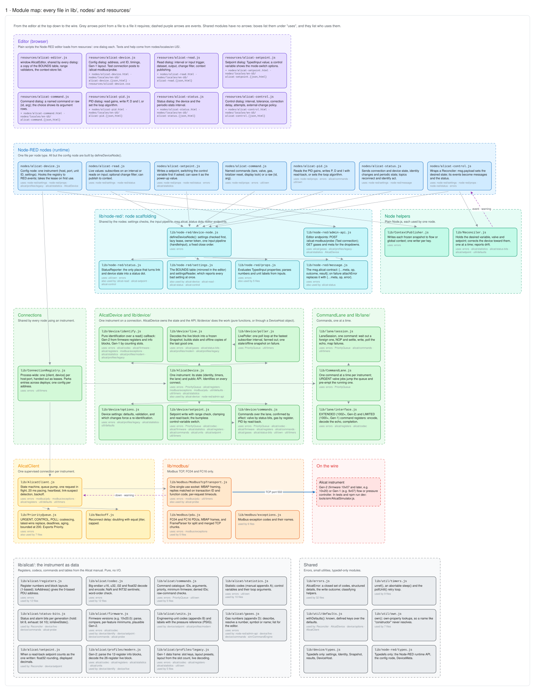
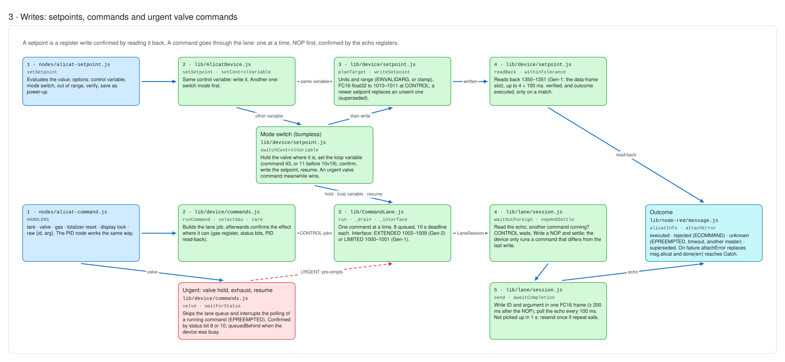
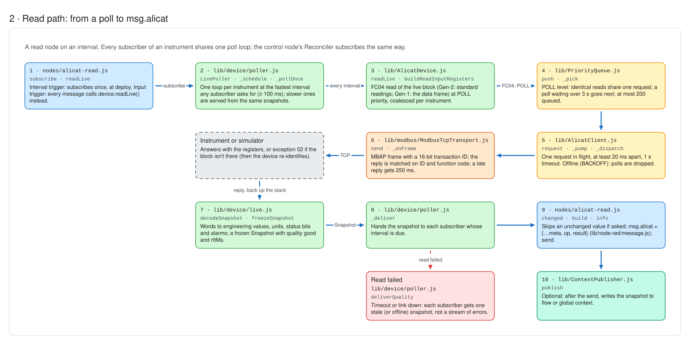
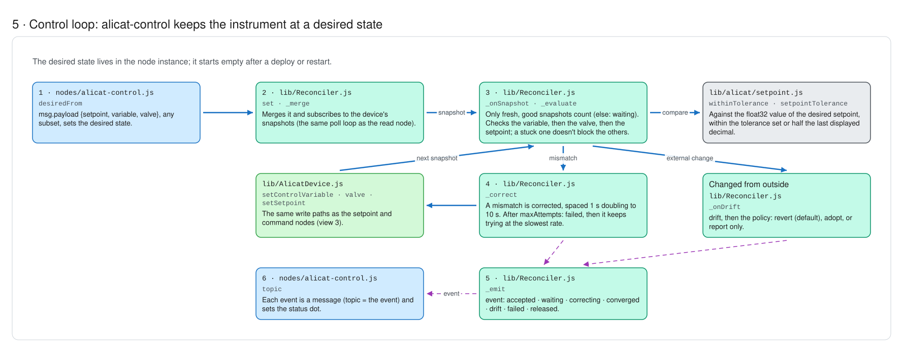
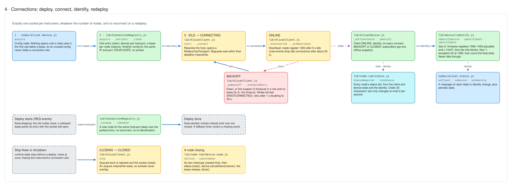
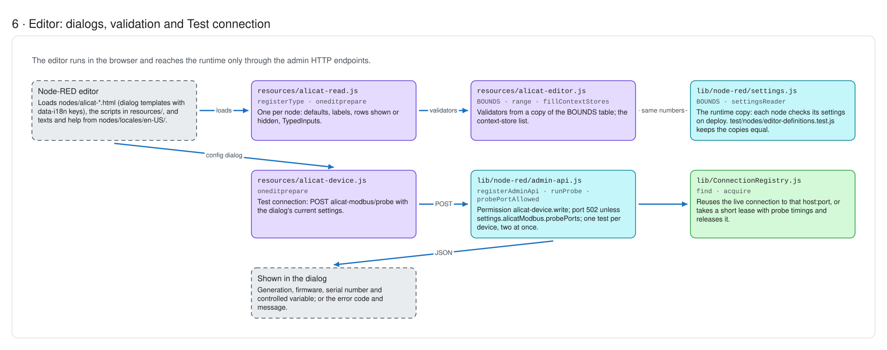
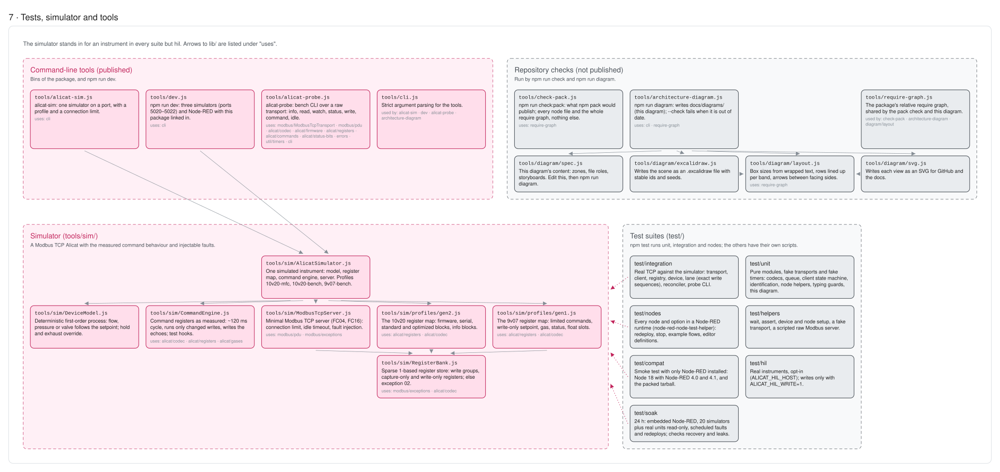

# Architecture

How the package turns Node-RED nodes into exactly one well-behaved Modbus TCP connection per instrument. The register-level details are in [register-map.md](register-map.md); what was measured on hardware is in [hardware-validation.md](hardware-validation.md).

**Diagram:** [diagrams/architecture.excalidraw](diagrams/architecture.excalidraw) shows every file and the main flows on one canvas. Open it in [excalidraw.com](https://excalidraw.com) (*Open*) or the VS Code *Excalidraw* extension; the pictures in this document are its views ([how to read them](diagrams/legend.svg)). It is generated by `npm run diagram` from `tools/diagram/spec.js` and the code's `require()` calls, and a unit test fails when it falls behind the code.

## Layers



```
 Node-RED nodes (read, setpoint, command, PID, status, control)
   │ defineDeviceNode(): settings checked first, lease from the config node, per-instance owner
   │                     token, StatusReporter, one input pipeline, one close order
   ▼
 alicat-device config node ── lease = registry.acquire({host, port, unitId, …})   (lazily, on first use)
   ▼
 ConnectionRegistry   one entry per host:port → {client, device}; parks entries across deploys
   ▼
 AlicatDevice         state and lifecycle; lib/device/: identify (Gen-1 / Gen-2) · decode · shared poll
   │                  loop · setpoint · mode switch · valve · commands
   │                  └─ CommandLane: one command at a time, urgent pre-emption;
   │                     lib/lane/: NOP/echo handshake on the extended or limited interface
   ▼
 AlicatClient         state machine · PriorityQueue · one request in flight · pacing · heartbeat · backoff
   ▼
 ModbusTcpTransport   net.Socket · MBAP framing · 16-bit transaction IDs · per-request timeouts
```

Everything below the nodes is plain Node.js with no dependencies, and is tested without Node-RED.

## ModbusTcpTransport (`lib/modbus/`)

One TCP connection, used once: when it goes down it is discarded, and the client makes a new one.

- **Framing:** a `FrameParser` reassembles split and merged TCP chunks. A frame with a bad protocol ID or length is `EFRAMING`, and the socket is destroyed, because a byte stream can't be resynchronised safely.
- **Matching:** replies are matched on the 16-bit transaction ID **and** the function code. Unknown or late frames are counted and dropped.
- **Late replies:** after a timeout, the next request waits up to 250 ms for the late frame, so a slow device isn't mistaken for a dead one.
- **Down handling:** `error`, `close`, `end` and `timeout` all go through one idempotent `_down()`. It emits `down` once and rejects every pending request with `ELINKDOWN`. Retired sockets keep an error listener, because an unhandled `'error'` would crash Node-RED.
- Only **FC04** (read input registers) and **FC16** (write multiple registers) are used. FC16 replies are validated against the request.

## AlicatClient (`lib/AlicatClient.js`)

One supervised connection per instrument, shared by every node that uses it.

**State machine** (table-driven; illegal transitions throw in tests):

```
 IDLE ─start→ CONNECTING ─connected→ ONLINE ─down / link suspect→ BACKOFF ─retry timer→ CONNECTING
 any ─stop→ CLOSING → CLOSED
```

| Behaviour | Default | Why |
|---|---|---|
| Requests in flight | 1 | The instruments are single-threaded Modbus servers |
| Gap between requests | 20 ms | About 50 Hz, the documented device rate |
| Request timeout | 1000 ms | A timeout fails only that request |
| Dead link | 3 timeouts in a row **and** no bytes for 2× the timeout | A slow reply doesn't cause a reconnect storm |
| Heartbeat | 5 s idle → read register 1200 | Instruments drop connections idle for about 20 s |
| Backoff | 1 s doubling to 30 s, equal jitter | Reset only after 10 s stable with no timeouts |
| Offline (BACKOFF) | Writes fail fast with `ENOTCONNECTED`; polls are dropped | No silent, delayed actuation |
| Connecting / identifying | Requests wait within their deadline | Startup work isn't rejected |

Before connecting, the client resolves the host name and **claims the address** in the registry. A second configuration that resolves to the same IP and port gets `EDUPLICATE` without opening a socket.

Connection-failure logs are rate-limited: the first failure, any change of error, then once a minute.

## PriorityQueue (`lib/PriorityQueue.js`)

Three levels, FIFO within each:

| Level | Used for |
|---|---|
| URGENT | Valve hold / exhaust / resume (`replaceKey: 'valve'`, so at most one is queued) |
| CONTROL | Setpoints, commands, PID, identification |
| POLL | Polling, on-demand reads, heartbeat, metadata refresh, editor probe |

- **Coalescing:** identical reads share one request; each waiter keeps its own deadline.
- **Replace (latest wins):** a newer setpoint replaces one that hasn't been sent; the old one resolves as `superseded`.
- **Deadlines:** an expired request is never sent late (`EQUEUETIMEOUT`).
- **Aging:** a poll waiting more than 3 s goes next, so polling can't starve.
- **Bounded:** 200 requests; the oldest poll is evicted first. Urgent requests and steps of a running command are never refused.

## CommandLane (`lib/CommandLane.js`, `lib/lane/`)



The lane keeps the queue (priorities, pre-emption, cancel, close); `lib/lane/session.js` runs one command through the steps below, and `lib/lane/interface.js` holds the two command interfaces (encoding, echo decoding, completion). A characterisation test pins the exact writes of each scenario.

Alicat commands are written to command registers and confirmed by polling an echo. Hardware testing (Gate 0) showed three things that shape the protocol:
1. The device runs a written command only if it **differs from the previous write on the same interface**. That previous write can't be read back.
2. The device samples the command registers every **110–125 ms**.
3. A command written while another is running is **queued by the device**, not run at once.

So, per instrument, one command at a time (8 queued at most, 10 s deadline each):

```
1. Read the echo. Another command still running? CONTROL waits; URGENT doesn't.
2. Always write a NOP first, then settle:
     echo showed a command → poll until it shows 0
     echo already 0        → wait 300 ms (the NOP may not count as a change)
   The command goes out at least 200 ms after the NOP (a 9v07 dropped one sent sooner).
3. Write the command (ID and argument in one FC16 frame).
4. Poll every 100 ms until the echo shows it finished:
     Gen-2 (extended, 1002–1009): status 0 → executed, 2–7 → rejected (ECOMMAND)
     Gen-1 (limited, 1000–1001):  1001 ≥ 0x8001 → rejected; status = value − 0x8000 + 1
5. Not picked up within 1 s? Repeat-safe commands (gas, valve, gains, mode, display, queries) are
   sent once more. Tare and totalizer reset never are: their outcome becomes unknown.
```

**Urgent valve commands** skip the lane queue and interrupt the *polling* of a running command, which then ends with `EPREEMPTED` (outcome `unknown`). They can't make the device act sooner. If the device is still running a command, the result reports `queuedBehind`. With the opt-in fallback, *hold closed* also writes setpoint 0 at once. Valve commands are confirmed by their **effect**: the hold bit (status bit 8) or the exhaust bit (bit 10).

If the echo shows a command this client didn't send, the lane reports `unknown` and warns once about another master.

## AlicatDevice (`lib/AlicatDevice.js`, `lib/device/`)

`AlicatDevice` owns the state (identity, timers, the lane) and the public API. The work is in `lib/device/`: `identify.js` (pure functions over a `read()` callback), `live.js` (decode and freeze snapshots), `poller.js` (the shared poll loop), `setpoint.js` and `commands.js` (through a `DeviceHost` capability object, never the device itself), with the types in `types.js`.

**Identification** runs on every connect, and again (at most every 30 s) when a live read gets exception 02. It needs positive evidence and never falls through from one generation to the other:
- **Gen-2** (firmware registers 1090–1093 plausible and ≥ 10v07): read the standard block and the info blocks. Readings with info type 0 or 1 are absent. The setpoint's info type gives the controlled variable (37 mass flow, 38 gauge pressure, 45 valve drive, …).
- **Gen-1** (exception 02 or `0xFFFF` at 1090): read the gas register, then probe float slots from 1203 until exception 02. A timeout during the probe retries identification; it is never taken as the end of the slots. The slot count must match the configured layout.
- A change of generation, firmware or serial is flagged as `identityChanged`.



**Polling:** `subscribe()` runs **one** poll loop per instrument at the fastest interval any subscriber asks for (minimum 100 ms) and serves slower subscribers from the same snapshots. When reads fail, subscribers get one `stale` (or `offline`) snapshot, not a stream of errors. Gen-2 units and ranges are refreshed every 60 s.

**Setpoints:** written as float32 to 1010–1011 and confirmed by reading back (1350–1351 on Gen-2, the data-frame setpoint slot on Gen-1). `verified` says whether the read-back matches, and the outcome is `executed` only when it does. `clamped` means this library limited the value to the device range.

**Mode switch** (bumpless): hold the valve at its current position → set the loop variable (command 43 on 10v19+, else 11) → write the setpoint → resume. On Gen-2 the new mode is confirmed from the setpoint info type, retrying up to 5 × 200 ms while the info block updates. A valve that was already held stays held.

## Reconciler (`lib/Reconciler.js`, the `alicat-control` node)



Holds a desired `{setpoint, variable, valve}` and corrects the device toward it:
- It acts only on **fresh, good** snapshots; on stale or offline data it reports `waiting`.
- Dimensions are checked in order (variable, then valve, then setpoint), and a stuck one doesn't block the others.
- Setpoints compare against the float32 value of the desired setpoint (0.1 is stored as 0.10000000149), within the configured tolerance or, by default, half of the device's last displayed decimal (at least a relative 1e-6).
- Corrections are spaced out (1 s doubling to 10 s). After *maxAttempts* failures it emits `failed` and keeps trying at the slowest rate.
- External changes emit `drift`, then follow the policy: revert (default), adopt, or report only.
- The desired state lives in the node instance. It starts empty after a deploy or restart.

## ConnectionRegistry (`lib/ConnectionRegistry.js`)



A process-wide singleton (on `globalThis`, under a versioned symbol, so duplicate copies of the package share it). It owns each instrument's client and device, keyed by host and port.

**Leases:** `acquire()` returns a lease with a unique token; `release()` is idempotent. A late cleanup from an old node instance can't touch the new instance's work.

**Deploys:** Node-RED stops every old node before starting the new ones, and a node's close handler can't tell a redeploy from a shutdown. The registry listens to `RED.events` instead:

| Event | Effect |
|---|---|
| `flows:stopping` | Leases released during the deploy **park** their entry, socket still open |
| re-acquire during the deploy | Takes over the parked entry: **no reconnect** |
| `flows:started` | Entries nobody re-acquired are closed |
| `runtime-event` `runtime-state` with `state: 'stop'` and no `deploy` flag | *Stop flows* or shutdown: close at once, freeing the instrument's connection slot |
| fallback timer (Node-RED close timeout + 5 s) | Closes parked entries if `flows:started` never arrives |

Outside a deploy, an entry lingers for 1 s after its last lease is released. An acquire during closing waits for the old socket to close first, so sockets never overlap.

## Node-RED glue (`lib/node-red/`, `nodes/`)



- **`defineDeviceNode`:** every node except the config node is built with it. Settings are read and range-checked first (`settings.js`, one bounds table shared with the editor); a node with no device or invalid settings shows a red status and fails every input with `EINVALIDARG`, and never opens a connection. Inputs go through one pipeline (`handleInput`), and close runs in a fixed order: the node's own cleanups, the status, its queued requests, the lease.
- **Lazy lease:** the config node opens the connection when the first node uses it, so an unused or imported configuration never occupies a connection slot.
- **Owner tokens:** each node instance has its own token for cancelling its queued work on close.
- **Status:** `StatusReporter` is the only place that maps link and device state to a status dot. Text stays under 20 characters; colour changes show at once, and text-only changes are limited to 2 per second.
- **Messages:** `message.js` builds `msg.alicat` (instrument, `op`, `outcome`, `result`). On failure `{code, message, outcome, …}` replaces `msg.alicat` and the node calls `done(err)`, so Catch nodes get the details.
- **Editor:** scripts in `resources/` (validators from the same bounds table, the context-store list), texts and help in `nodes/locales/`.
- **Editor endpoints:** `POST /alicat-modbus/probe` (Test connection; `alicat-device.write` permission; reuses the live connection; port 502 unless `alicatModbus.probePorts` allows more; two tests at a time) and the gas and layout tables.

## Tests



| Suite | What it covers |
|---|---|
| `test/unit` | Framing, codec, firmware, queue, backoff, client state machine (fake timers), identification over fake reads, one file per table and node-red helper, typing and source hygiene guards |
| `test/integration` | Transport, client, registry, device, lane (including the write-sequence characterisation) and reconciler against the simulator, with injected faults; the probe CLI |
| `test/nodes` | Every node and its options in a Node-RED runtime (node-red-node-test-helper), redeploy and stop behaviour, every example flow, editor definitions (catalog keys, validators, help) |
| `test/compat` | Runtime smoke test with only Node-RED installed; CI runs it on Node 18 with Node-RED 4.0 and 4.1, and against the packed tarball |
| `test/soak` | Embedded Node-RED, 20 simulated plus optional real instruments, scheduled faults, redeploys and stop/start; checks collisions, recovery, leaks and latency |
| `test/hil` | Opt-in checks against real instruments (writes only with `ALICAT_HIL_WRITE=1`) |

The simulator (`tools/sim`) models the measured command semantics (change detection per interface, device cycle, queued commands, dropped commands, idle disconnects) and can inject faults: silence, resets, garbage, refused connections, exceptions, delays and split frames.
